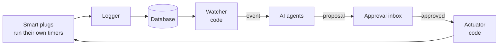

# AgentC Edge

[](https://github.com/PaSathees/agentc-edge/actions/workflows/ci.yml)

Helps a small site meet a monthly carbon goal, starting with a home. The site's carbon comes from the electricity it uses, so plain code watches every smart plug all the time. When something looks off, an AI agent takes a look with what it knows about the home's devices and habits, and asks the owner a short question while it is happening. A person approves every change before it reaches a device.

> Status: in development. Design version 2 is being built; the commands below are from version 1. Built in the open, step by step (`docs/`). Words and codes are explained in the [glossary](docs/glossary.md).

## How it works



- **AI only when needed:** plain code checks the readings every few minutes. The AI runs only when it finds something, so a quiet day costs nothing.
- **A person decides:** every change is a proposal. Nothing reaches a plug without approval. It starts in shadow mode: it suggests, but writes nothing.
- **Code does the maths:** kWh, cost and carbon are worked out in code. The AI explains and suggests.
- **Runs at the site:** one old laptop. Only the AI calls leave it.

## Commands

| Command | Does |
|---|---|
| `agentc timers` | Reads every plug and shows its timers in plain words. Problems come last |
| `agentc profile Plug-6` | Shows a plug's usual week, hour by hour, and the kWh it used |
| `agentc watch` | Runs the checks that are due now and shows new events |
| `agentc replay --days 14` | Plays past days through the Watcher. Your real data is not changed |

None of these change a plug. They only read.

## Quickstart

```bash
cp config.example.toml config.toml   # add your plugs and tariff
python3 logger/logger.py energy.db config.toml   # start recording, one reading a minute
uv run agentc timers
```

## Develop

Needs [uv](https://docs.astral.sh/uv/). Tests use a fake plug, so no hardware is needed.

```bash
uv sync                      # Python 3.12 and the libraries
uv run pytest                # all tests, with coverage
uv run ruff check . && uv run basedpyright   # style and type checks, as in CI
uv run uvicorn agentc.app:app                # the app at localhost:8000/health
```

## Results

Not measured yet. See [evaluation](docs/evaluation.md).

## How it is built

Five phases, each with its own documents:

| Phase | Documents |
|---|---|
| Specify: what it must do | [requirements](docs/requirements.md), [review of the first version](docs/audit.md) |
| Design: how it will work | [design](docs/design.md) (version 2), [decision records](docs/adr/) |
| Evaluate: does it work | [evaluation](docs/evaluation.md) |
| Operate: running it | [operations](docs/operations.md) |

The method: [docs/process.md](docs/process.md).

## Folders

```
logger/   the plug logger (Python standard library only)
src/      the app: the agentc package
tests/    tests and the fake plug
deploy/   setup scripts for the hub
docs/     requirements, design, decisions, evaluation, operations
```

## Limits

- Home smart plugs are not industrial data. Industrial protocols and the grid are simulated where used.
- A personal project. Not linked to CEB, PUCSL or SLSEA.
- The tariff in `config.example.toml` uses fake rates. Check your own bill.
- It can switch real plugs. Use it at your own risk. Never put it on medical, safety or fire-risk loads.
- Carbon figures are estimates from a published grid factor, not a certified report.

## License

Apache-2.0. See [LICENSE](LICENSE).
