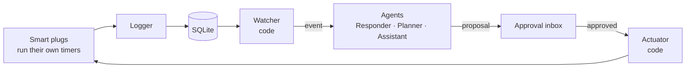

# AgentC Edge

[](https://github.com/PaSathees/agentc-edge/actions/workflows/ci.yml)

Edge agents for energy and carbon operations. Code watches the meters, agents wake only when something happens, and a person approves every change before it reaches a device.

> Status: in development. Built in the open with a documented process (`docs/`).

## How it works



- **Event-driven:** no daily LLM run. LLM cost follows events, not devices.
- **Human in the loop:** every change is a proposal; nothing is written without approval. Shadow mode first.
- **Code does the maths:** kWh, cost and kgCO2e are computed in code; agents explain and propose.
- **Runs on the edge:** one laptop inside the site; only model API calls leave the box.

## Quickstart

```bash
cp config.example.toml config.toml   # add your plugs
python3 logger/logger.py energy.db config.toml
```

## Develop

Needs [uv](https://docs.astral.sh/uv/). Tests use a fake Tasmota plug, so no hardware is needed.

```bash
uv sync                      # Python 3.12 and dependencies
uv run pytest                # tests with coverage
uv run ruff check . && uv run basedpyright   # lint and types, as in CI
uv run uvicorn agentc.app:app                # app at localhost:8000/health
```

## Results

Not measured yet. See `docs/evaluation.md`.

## Engineering process

Five phases (specify, design, build, evaluate, operate), each with its artifacts:

| Phase | Artifact |
|---|---|
| Specify | [requirements](docs/requirements.md), [audit of v1](docs/audit.md) |
| Design | [design overview](docs/design.md), [details](docs/design/), [ADRs](docs/adr/) |
| Evaluate | [evaluation](docs/evaluation.md) |
| Operate | [operations](docs/operations.md) |

Process and conventions: [docs/process.md](docs/process.md).

## Repository layout

```
logger/   plug logger (stdlib only)
src/      the app: agentc package
tests/    pytest tests and the fake Tasmota plug
deploy/   hub setup scripts and systemd units
docs/     requirements, design, ADRs, evaluation, operations
```

## Limits

Home smart plugs are not industrial data. Industrial protocols and the grid are simulated where used.

## License

Apache-2.0. See [LICENSE](LICENSE).
