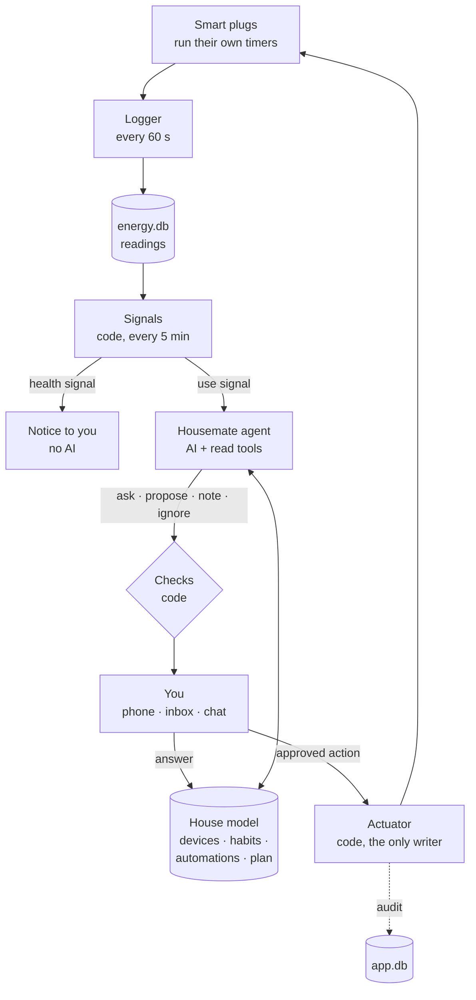
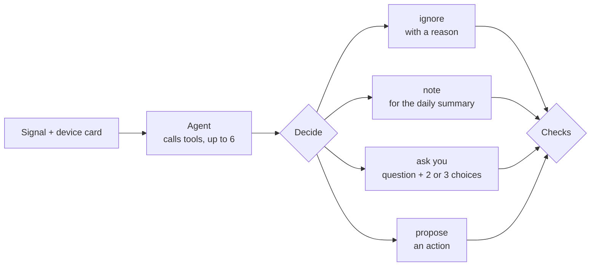

# Design

Version 2, 2026-11-21, after the owner's review walkthrough. It replaces version 1 (2026-11-12), which is in git history. The reasons for the change are under "Why version 2".

How the system in [requirements.md](requirements.md) is built. Words and codes are explained in the [glossary](glossary.md). Big decisions are in [adr/](adr/).

## Read this first

The system is a **housemate** for the home's electricity. It knows the devices, how you use them, and the timers you have set. When something looks off, it takes a look first, and only then asks you a short question while it is still happening. Your answers teach it your habits.

Who does what:
- **Code** watches the readings all the time (cheap, the same every time), does every sum, checks every answer, and is the only thing that changes a plug.
- **The AI** does the judging: is this odd, or just you? Is it worth asking? What is the clearest question?
- **You** answer, approve, and correct it.

One real example. On Monday 2 November, at 01:37, Desk 2 switched on and then sat at 5 W until morning.

| | Version 1 (built) | Version 2 (this design) |
|---|---|---|
| When it notices | 04:37, after 3 hours of a small load | About 02:10: on since 01:37, so left on after 30 minutes, seen by the next 5-minute pass |
| What it knows | The name "Desk 2" and its usual week | Laptop charger, monitor and speaker; a work desk; you work late on Thursdays; no timer on it; nothing else on in the house |
| What it does | After the run ends: a timer for future nights, A or B | Asks you a question at 07:00 (5 W is too small to wake you at night) |
| What it learns | A rejection blocks the same fix for 14 days | Your tap becomes a habit or an action, and an eval case |

The version 2 question on your phone at 07:00:

> Desk 2 was on from 01:37 to 07:00 last night at about 5 W. It's usually off by 01:00 and nothing else was on.
>
> **Set a timer** · **That's normal on Mondays** · **Ask me at night next time**

A 1,500 W heater left on would not wait: above 50 W it asks at once, even at night.

## Why version 2

The audit and walkthrough of 17 to 21 November found that version 1 solved a narrow problem with a lot of code:
- In 14 real days it made 0 proposals. On 3 public homes (REFIT) it found 0 fixes. Most "odd" use is real use at an odd hour, which a timer cannot fix.
- The AI only picked option A or B, both built by code. That needs no AI.
- It acted too late: a fix for future nights, never "did you mean to leave this on?"
- It knew almost nothing about the devices, so it could not judge why something happened.

Version 2 keeps what was sound (code for maths, checks and writes; event-driven AI; approval for every change) and moves the judging to an agent with context and tools.

## The parts

| Part | Does | Code or AI |
|---|---|---|
| Logger | Reads every plug once a minute into `energy.db`. A separate program | code (built) |
| House model | What the system knows about the home: devices, habits, automations, the plan | data, kept by code |
| Signals | Finds things worth a look, early and cheaply. Never calls the AI | code |
| Housemate agent | Looks into one signal with tools, then decides what to do | AI (one of three agents on a shared base) |
| Checks | Validates everything the agent produces before you see it | code (built, extended) |
| You | Answer questions, approve actions, chat | owner |
| Actuator | Writes to a plug after approval, reads it back, logs it | code |
| Chat and Planner agents | Own prompts, tools and models, on the same base | AI (Phase 5) |

## 1. House model: the context

The agent is only as good as what it knows. Version 1 had a name per device. Version 2 keeps a small model of the house in `app.db`: each device's card, why each timer is there, and habits. It lives in the database so the setup chat and chat can propose changes for you to approve. `config.toml` keeps only what no agent may ever change: names, access levels, rules, budget. `agentc house` shows the house model exactly as the agent will read it, and `agentc house Plug-6 room=study` changes a card.

| What | Example | Comes from |
|---|---|---|
| Device card | Desk 2: work desk, study. Laptop charger, monitor, speaker. Kind: computer. Must run: no | Setup chat, then edits |
| Placement | Desk 2 on Plug-6 since 1 Nov | Setup; a change point asks again |
| Habit | "Desk 2 runs until 02:00 on Thursdays" | Your taps and chat |
| Automation | Timer 3 on Plug-4: TV on at 06:00 daily. Why: "morning news" | Imported timers; the why from setup chat |
| Plan | Next week's intended on and off times | The Planner (Phase 5) |
| Tariff and factor | Block tariff; 0.4242 kgCO2e/kWh (SLSEA, 2023) | Config, with source |
| Past signals | Desk 2 left on: 3 times, you said "switch off" twice | Kept by code |

**Setup chat.** For each plug the agent asks about five questions: what is plugged in, when it is used, must it stay on, which room, and is anything else on the same socket. It shows the card back, and you confirm before anything is saved. Until the setup chat is built, you set the card yourself with `agentc house`. Device kinds come from a short fixed list (charger, computer, media, kitchen, fridge, fan, heater, light, router, printer, other), because code uses the kind: a fridge or router must run, so it raises no "left on" or "unusual use" signals.

Later, the ontology work (ontolab) can turn these cards into a formal model. The tables come first because they are enough to start, and easy to read.

## 2. Signals: worth a look

Signals are plain code, run every 5 minutes. Their job changes from "decide" to "notice". The bar is low on purpose, because the agent decides what matters.

| Signal | Means | Example |
|---|---|---|
| Left on | Power near the device's standby level for 30 minutes, at an hour it is usually off | Desk 2 at 5 W from 01:37 |
| Unusual use | Well above its usual for this hour | A 60 W load on a plug that is usually 5 W |
| Automation drift | A timer turned it on, but it only draws standby: on for nothing | TV switched on at 06:00, no one watches until 19:00 |
| Override | A timer turned it off, but it draws power: someone switched it back | |
| Change point | Its power levels shift for good: a new device on the plug | Plug-6 now 60 W when on, was 25 W |
| Peak use | Heavy use in the expensive hours, on a time-of-use tariff | Kettle at 19:00 |
| Health | Plug offline · every plug silent (power cut or the hub's Wi-Fi) · no reading for 5 minutes (logger stopped) | |

Health signals go straight to you as a notice. They need no AI, and they must work when the internet is down. Fridges and other must-run devices raise no "left on" or "unusual" signals.

## 3. Housemate agent: take a look, then decide

One signal at a time, and at most one question per signal. It reads a short brief (the signal and the device card), then calls read-only tools until it can decide. Code does every sum inside the tools, so the agent never adds numbers itself.

Code skips what needs no look, so no model is called: a habit that covers the signal, or a timer's drift that is not a pattern yet. A timer is looked at once it drifted on 3 of the last 7 days (`drift_days`), and then once a week. Health signals (offline, logger stopped) never reach the agent.

**Tools (read only)**

| Tool | Returns |
|---|---|
| `device(name)` | The device card, placement and access |
| `power(device, from, to)` | The stretch in plain segments: "01:37 to 01:50 about 30 W, then about 5 W" (not raw minutes) |
| `usual(device, day, hour)` | The usual power and how often it is on at that hour |
| `house_now()` | What every plug is doing right now |
| `automations(device)` | Its timers in plain words, with why |
| `habits(device)` | Habits and past answers about it |
| `past_signals(device, kind)` | Similar signals and what you said each time |
| `plan(device)` | What the plan says should happen (Phase 5) |
| `cost(device, from, to)` | kWh, LKR and kgCO2e for a stretch, from code |

**What it may produce**
- **ignore**: logged with a reason, so you can audit what it chose not to raise.
- **note**: one line in the evening summary. For small things not worth an interruption.
- **ask**: a question with 2 or 3 choices. Each choice maps to something code knows how to do: switch off now, set a timer, save a habit, or remind me later.
- **propose**: an action (switch off now, add or change a timer, move use to cheaper hours), with its saving from `cost`.

**The loop** is our own small loop on `llm()`: the model asks for a tool, code runs it, up to 6 times ([ADR-009](adr/009-own-agent-loop.md)). The agent never stops itself: every limit sits in code.

**Limits:** up to 6 tool calls and USD 0.01 per signal, on Claude Haiku (a small, cheap model).

**Cost estimate**, from version 1's measured calls. Each step of a run re-sends the conversation so far, so a 6-step run costs several single calls.

| | Cost | How |
|---|---|---|
| One model call | about USD 0.0003 | Measured: USD 0.0053 for 20 calls |
| One signal | about USD 0.002 to 0.003 | 6 steps, growing context |
| One month | about USD 0.15 to 0.50 | 2 to 5 signals a day; the cap is USD 3 |

Prompt caching (re-using the unchanged start of a prompt at a lower price) cuts it further. Phase 3 measures the real cost from the traces.

**Every number traces to a tool.** In the Desk 2 run, "usually off by 01:00" needs `usual()`, and offering "Set a timer" needs `automations()` (is there a timer already, which slots are free). A number with no tool behind it is blocked by the checks.

**Three agents on a shared base.** The housemate (signals), chat and the Planner are separate agents: each has its own prompt, its own subset of tools, its own model and its own evals. The Planner will later get forecasting tools, and one prompt for three jobs would be hard to keep right. They share one base: the house model, the tool library, the checks and `llm()`. So each one has the whole view, and each one can change and be tested on its own ([ADR-007](adr/007-housemate-agent.md)).

| Shared (one copy) | Separate (per agent) |
|---|---|
| House model, tool library, checks, `llm()` and budget | Prompt, which tools it may use, model, evals |

## 4. You: the owner loop

- **Phone.** The question arrives through ntfy, a push notification service, with one button per choice. Each button carries a single-use token for that question and that choice.
- **Inbox.** The same questions and proposals on a local web page. It is the fallback when the internet is down.
- **Night questions.** Quiet hours are 23:30 to 07:00. At night it asks only if the device draws more than **50 W** (`night_wake_w` in config), or if you turned night questions on for that device. Below that, the signal waits and becomes a morning question. Size decides, not time: waking you for 5 W is worse than the waste; a heater left on is not.
- **Rate limit.** At most 5 questions a day, and never the same question about the same device twice in a day.
- **Every answer is kept.** A tap like "That's normal on Mondays" becomes a habit row. Code builds it from the question, so no AI is needed, and shows the scope back: "Saved: Desk 2 is normal on Mondays, 01:00 to 07:00". Too wide hides waste; too narrow keeps asking. A free-text answer is turned into a habit by the agent and shown back for you to confirm.
- **Habits get re-checked.** After 30 days, or after a change point on that plug, it asks once: "Still true?"
- **Later, earned auto-off.** After you answer "switch off" 3 times for the same situation, it may ask once: "Next time, switch Desk 2 off on its own if you don't answer in 30 minutes?" Only if you opt in, per device, only for low-power standby, never for must-run or access *none* devices, and back to asking after one "that was wrong". Silence alone never counts as yes. It needs its own decision record (Phase 4 or later). It is better than a timer: a timer cuts every night, this only acts when the device really is left on.

## 5. Actions: the only writes

| Action | How | Undo |
|---|---|---|
| Switch off now | One `Power Off` command, after your tap ([ADR-008](adr/008-one-off-switch-off.md)) | Switch it on at the plug or from the inbox |
| Add or change a timer | Written as one change: the "on" timer first, each read back, all or nothing | A new proposal that restores the old timers |
| Save a habit or rule | A row in the house model | Edit or delete on the device page |

Write-time checks, kept from version 1:
- The approval is for this exact version and has not expired.
- Access and rules are checked again.
- The owner's own timer slots are never touched.
- At most 4 writes per plug a day.
- Read back within 30 seconds.

**Shadow mode** records approved actions and writes nothing. Phase 3 runs in shadow mode.

## 6. Checks and guardrails

The checks from version 1 stay, extended to the new outputs:
1. **Format:** the answer matches the schema; each choice maps to a known action.
2. **Grounded:** every number and time in the text appears in a tool result.
3. **Access:** the device allows it. Each device has an access level set by you: *none* (never touched), *propose*, or *write after approval*. A device with access *none* (the 3D printer) never gets a question or an action.
4. **Rules and habits:** no hard rule broken; a habit that says "normal" stops the question.
5. **Repeats and rate:** not a repeat of something you answered or rejected; within the daily limit and quiet hours.

On failure the agent gets one retry with the reason, then the draft is dropped and logged. Device names and notes are passed as data, never as instructions. `llm()` removes IP and MAC addresses, records every call, and stops at the budget caps.

## 7. Chat and Planner (Phase 5)

- **Chat** is a separate agent on the shared base, started by your message. It has the read tools, plus draft tools that create a habit, a rule or a proposal, which go through the same checks. "Keep the TVs on until 1 on Fridays" becomes a rule you confirm.
- **Planner** is a separate agent on the shared base, started every Sunday. It reads the week's signals, answers and automations, and proposes timer changes as one plan. On a time-of-use tariff it also suggests moving use to cheaper hours. Version 1 planned a solver for this (CP-SAT, a tool that finds the best timetable within the rules; [ADR-003](adr/003-solver-not-llm-loop.md)). It is on hold until plans are big enough to need it.

## 8. Evals: how we know it works

Your answers are the labels, so the eval set grows on its own. False alarms and missed waste are always reported together (precision and recall): an agent that never asks has no false alarms.

| Measure | From | Target |
|---|---|---|
| False alarms | Share of questions that were really your habits ("that's normal") | 40% or less |
| Missed waste | Nights you mark "should have asked" | Counted, reviewed weekly |
| Interruptions | Questions a week | 5 or fewer |
| Grounded | Numbers in text found in tool results | 100% |
| Cost | USD a month | 3 or less |
| Trajectory | Replays of real nights: did it call sensible tools and stop in time? | Reviewed by hand, then scored |

Replay cases come from real nights (like Desk 2 on 1 to 2 November) with a scripted owner, run in CI from recorded model answers. A live run is needed when a prompt or model changes, the same as version 1.

## When something fails

| Failure | What happens |
|---|---|
| Internet down | Logger, signals, health notices on the local inbox, and the Actuator keep working. AI signals wait and run when it returns. Other jobs never stop because an AI call failed |
| AI call keeps failing for one signal | After 3 tries the signal is parked and flagged, so it does not block the others |
| Logger stopped | "No reading for 5 minutes" health notice |
| Every plug silent | "Lost contact with every plug: power cut or the hub's Wi-Fi" |
| Write fails or read-back differs | Old timers kept; marked "write failed"; notice in the local inbox. No automatic retry |
| Budget cap | AI signals wait; health notices still go out |

## What changes in the code

| | Parts |
|---|---|
| **Keep** | The logger · the plug adapter · the maths for kWh, tariff and carbon · usual-week profiles · the database module · `llm()` · the checks · the fake plug used in tests · CI |
| **Change** | The Watcher becomes Signals: new kinds, every 5 minutes, a heartbeat · the Responder becomes the housemate agent with tools · the list of thresholds shrinks to a few settings · scheduled jobs catch AI errors so other jobs keep running |
| **Remove** | The code that built fix options A and B (done in 3c2, with the Responder and its evals) · most learned thresholds (only each plug's standby level stays, for "left on") |

New tables: `device` card fields (description, kind, must run), `habits`, `questions`, and a "why" column on `timers`.

## Settled facts

- **Grid factor:** 0.4242 kgCO2e/kWh, the 2023 average from the SLSEA Energy Balance. Scope 2 is the carbon from electricity you buy; "location-based" means it uses the grid's average factor. Hourly data (Electricity Maps covers Sri Lanka) is context only and not used yet.
- **Tariff:** the home is on a block tariff, so timing changes neither cost nor carbon; only fewer kWh help. Time-of-use is supported for sites that have it.
- **Goal:** measured November kWh minus 10% as December's goal.
- **ntfy:** self-hosted on the hub. For instant iOS push the public server relays only a message id; the phone fetches the text over Tailscale.
- **Network:** Tailscale only (a private network between your own devices); no port open to the internet.

## Decisions from review

- **Night questions:** only above 50 W (`night_wake_w` in config), or for chosen devices. Otherwise a morning question.
- **Device cards:** a setup chat, then a form to edit.
- **Bigger loads:** a fan and a kettle go on plugs, so savings are not only standby. The plugs are rated 10 A (about 2,300 W at 230 V), so only devices rated 2,200 W or less.

## Decision log

| ADR | Decision | Status |
|---|---|---|
| [001](adr/001-event-driven.md) | AI wakes on events (now: signals), not on a daily run | accepted |
| [002](adr/002-timers-on-device.md) | Schedules run as timers on the plug | accepted, with an exception in 008 |
| [003](adr/003-solver-not-llm-loop.md) | A solver builds the schedule; the model explains it | on hold until Phase 5 |
| [004](adr/004-proposals-as-rows.md) | Proposals are rows, not paused agent runs. Questions are rows too | accepted |
| [005](adr/005-llm-wrapper-and-tiers.md) | One `llm()` call site and model tiers | accepted |
| [006](adr/006-two-programs-sqlite-one-hub.md) | Two programs, SQLite, one hub | accepted |
| [007](adr/007-housemate-agent.md) | Agents with a shared house model and read tools replace code-built options | accepted |
| [008](adr/008-one-off-switch-off.md) | One-off "switch off now" after the owner's tap | accepted |
| [009](adr/009-own-agent-loop.md) | Our own small agent loop on `llm()`, not LangGraph | accepted |
