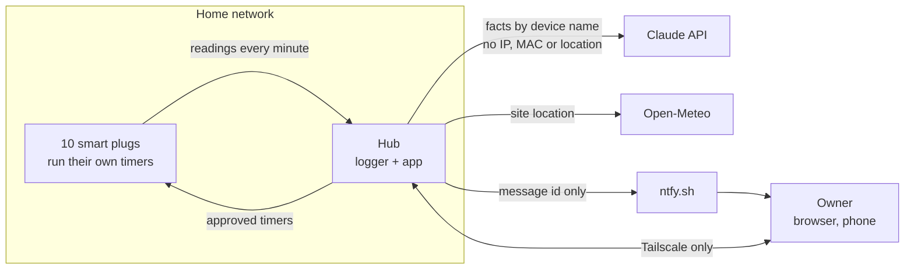
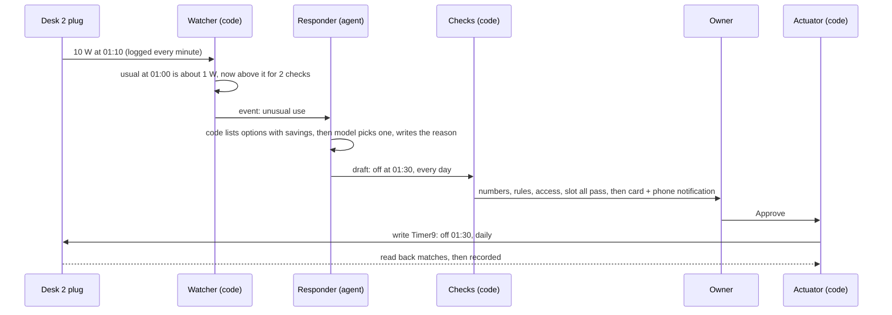
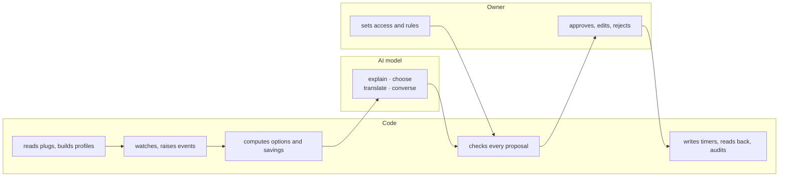
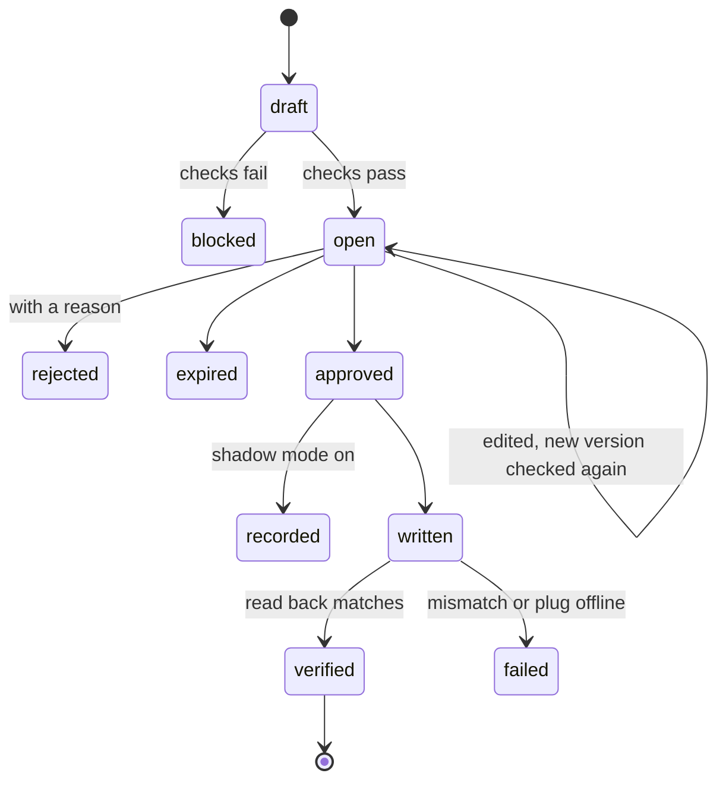

# Design

How the system in [requirements.md](requirements.md) is built. This page is the overview: read it first. The detail lives in [design/](design/), one file per topic, and the big decisions in [adr/](adr/).

## In three sentences

Smart plugs log power every minute to a small computer inside the home (the hub). Plain code watches that data all the time and raises an event only when something is unusual; only then does an AI agent wake up to propose a fix with its savings. The owner approves the fix on their phone, and code writes it to the plug as a timer, so the plug runs the schedule itself.

## The system and its boundary

Only three things leave the home: prompts to the model, a weather request, and a notification id. Proposal text, readings and addresses stay on the hub.

## One real example, end to end

From the logged data: the second desk (Desk 2) stayed on all night on 1 and 2 November, drawing about 10 W until 06:00. On 10 and 11 November it was in use until about 00:50.

The off time is 01:30, not 00:30, because the late working nights end before 01:00; code checks every option against usage like that before the model sees it. If the owner rejects it with "I sometimes work until 2", the reason becomes a soft rule and the same change is not proposed again. From then on the plug switches itself off with no software in the loop.

Cost: one call to a small model. On a day with nothing unusual, there are no AI calls at all. The same data is eval case EV-01.

## Who does what

Code computes every number, checks every rule and makes every write. The model only explains, chooses among options code computed, translates plain language into rules, and chats. It takes part in 9 of 25 steps and never writes, computes or decides alone. Full table: [autonomy map](design/autonomy.md).

## Life of a proposal

Every state change is an audit row. *Undo* on a verified change creates a new proposal that restores the previous timer, so an approval is never final.

## Terms

| Term | Meaning |
|---|---|
| Hub | The one computer that runs everything (an old laptop) |
| Plug, device | A plug is the hardware, known by its MAC address. A device is what is plugged into it; devices move between plugs |
| Timer, slot | Each plug has 16 built-in timers. A slot is a timer number the system may use (default 9 to 16; the owner's own are 1 to 8) |
| Profile | A plug's usual power for each hour of the week, from its history |
| Watcher | Code that checks the data every 15 minutes and records events. Never calls a model |
| Event | Something worth a look: unusual use, goal drift, plug offline, timer mismatch, grid event |
| Agent | A model that may choose which tools to call, within a fixed limit. Three: Responder (one event), Planner (weekly schedule), Assistant (chat) |
| Proposal | A suggested timer or rule change with its reason, savings and evidence. The only thing agents produce |
| Checks | Code that validates a proposal before the inbox and again before a write |
| Actuator | The only code that writes to a plug |
| Access level | Per device, set by the owner: None, Advice (FR-04 `propose`), Write after approval. New devices start at Advice |
| Hard, soft rule | Owner rules per device. Hard: a proposal that breaks it is blocked. Soft: allowed, with a warning |
| Shadow mode | Agents propose and the owner can approve, but nothing is written |

Tools: **LangGraph** (agent graphs), **CP-SAT** (OR-Tools solver), **SQLite**, **FastAPI**, **Next.js**, **ntfy** (phone notifications), **Tailscale** (private network).

## Detail

| Topic | What is in it |
|---|---|
| [Architecture](design/architecture.md) | Components, modules M-01 to M-16, failure behaviour, code layout |
| [Autonomy map](design/autonomy.md) | Steps D-01 to D-25: code, model or owner, with requirements |
| [Agents](design/agents.md) | Agent system diagram, tool access per agent, one graph per agent, limits and checks |
| [Guardrails](design/guardrails.md) | Layers, who sets what, proposal checks, write-time checks |
| [Data](design/data.md) | Tables, proposal contract, Tasmota timer fields |
| [UI](design/ui.md) | Tabs, wireframes, proposal card, first run |
| [Testing](design/testing.md) | Test levels, agent evals, shadow mode loop |
| [Open questions](design/open-questions.md) | The six questions from requirements, answered |

## Decision log

| ADR | Decision | Status |
|---|---|---|
| [001](adr/001-event-driven.md) | Agents wake on events, not on a daily run | accepted |
| [002](adr/002-timers-on-device.md) | Schedules run as timers on the plug | accepted |
| [003](adr/003-solver-not-llm-loop.md) | A solver builds the schedule; the model explains it | accepted |
| [004](adr/004-proposals-as-rows.md) | Proposals are rows, not paused agent runs | accepted |
| [005](adr/005-llm-wrapper-and-tiers.md) | One `llm()` call site and model tiers | accepted |
| [006](adr/006-two-programs-sqlite-one-hub.md) | Two programs, SQLite, one hub | accepted |
