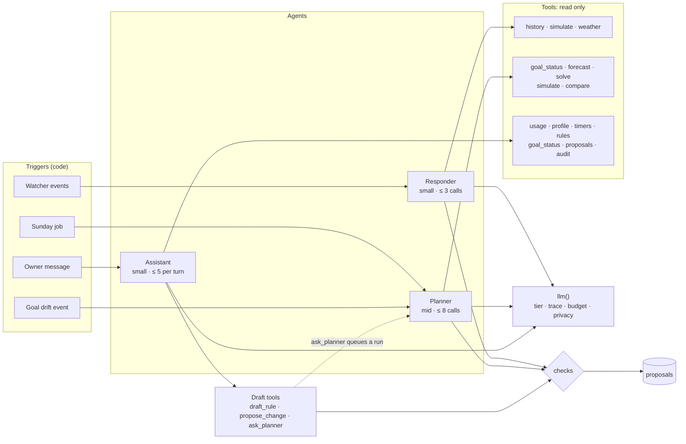
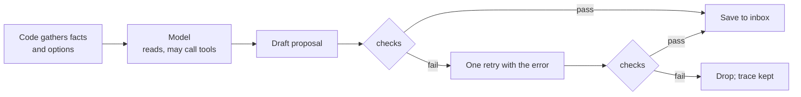
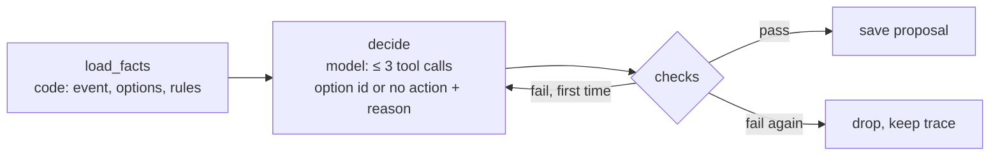
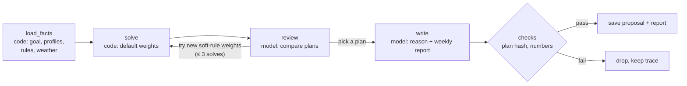
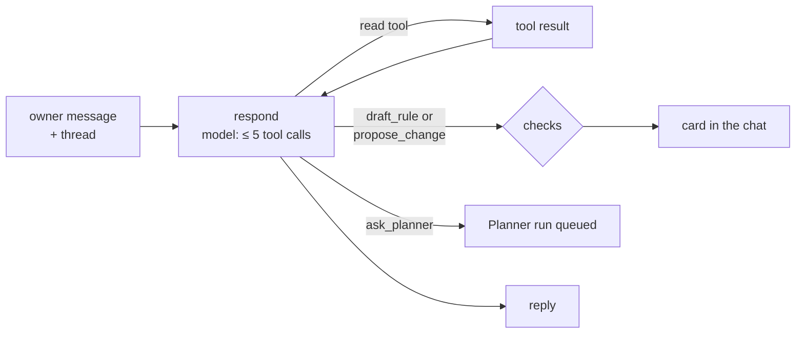

# Agents

[Design overview](../design.md)

Three agents, each with one job. The Responder handles a single event, the Planner rebuilds the week, and the Assistant answers the owner in chat. All three follow the same shape: code gathers the facts first, the model reads them and may call a few read-only tools, and the run ends in a proposal that code checks. None can write to a plug.

| | Responder | Planner | Assistant |
|---|---|---|---|
| Wakes on | Watcher events | Weekly, and on a goal drift event | An owner message |
| Job | Pick a fix for one event and explain it | Build next week's timers to meet the goal | Answer, and turn requests into proposals |
| Model tier | Small | Mid | Small |
| Tool calls | ≤ 3 per run | ≤ 8 per run | ≤ 5 per turn |
| Time | ≤ 30 s | ≤ 5 min | First reply ≤ 10 s |
| Output | 0 or 1 proposal per event | 1 plan proposal + weekly report | Chat reply; maybe a proposal or a Planner request |
| Memory between runs | None (reads past rejections from the store) | None | The chat thread |

Model tiers map to model names in config (NFR-18 swap provider). Time limits are NFR-05.

## Agent system

Three separate agents, each with its own trigger and its own small set of tools, rather than one agent that can do everything. They share three things: `llm()` for every model call, the checks for every draft, and the proposals table as the only output. The one link between agents is the Assistant's `ask_planner`, which queues a Planner run; agents never call each other directly.

### Tools

Every tool is a plain typed function over code modules. None writes to a plug; the draft tools only create a proposal, which goes through the checks like any other.

| Tool | Returns | Responder | Planner | Assistant |
|---|---|---|---|---|
| `history(device, days)` | Usage by hour, with the profile | ✓ | | |
| `usage(device, period)` | kWh and on-hours for a period | | | ✓ |
| `profile(device)` | Usual power per hour of the week | | | ✓ |
| `timers(device)` | Timers in plain words, with slot and source | | | ✓ |
| `rules(device)` | The device's rules, hard and soft | | | ✓ |
| `weather(days)` | Forecast temperature per day | ✓ | | |
| `forecast(device, days)` | Expected kWh per day | | ✓ | |
| `goal_status()` | Month so far, projection, on track or not | | ✓ | ✓ |
| `simulate(device or plan, timers)` | kWh, LKR, kgCO2e a week for a schedule | ✓ | ✓ | |
| `solve(weights)` | A week of timers that keeps every hard rule, with its hash | | ✓ | |
| `compare(current, plan)` | Changes and saving between two schedules | | ✓ | |
| `proposals(status)` | Open and recent proposals | | | ✓ |
| `audit(device, days)` | What changed, when, by whom | | | ✓ |
| `draft_rule(text)` | A rule proposal (draft) | | | ✓ |
| `propose_change(device, timers)` | A timer proposal (draft) | | | ✓ |
| `ask_planner(request)` | A queued Planner run | | | ✓ |

## Shared shape

- **Facts in, not data in.** Code computes the numbers the model needs (usage vs profile, options, savings) and passes them as a small JSON block. The model never gets raw readings to sum.
- **Names, not addresses.** Prompts use device names only; `llm()` removes any IP or MAC (NFR-14 privacy).
- **Prompts are files** in `agents/prompts/`, versioned in git, so an eval run names the prompt version it tested.
- **One retry.** A failed check goes back to the model once with the error text; a second failure drops the draft and keeps the trace for error analysis.
- **Limits are hard.** Reaching the tool-call limit ends the run; whatever is drafted goes to the checks, or nothing does.

## Responder

The common case: one unusual event, one fix.

- **Wakes on:** the events of one Watcher pass for the site, in one run (usually one event). Devices with access *none* are filtered out before the run.
- **Gets:** per event, the device, what was seen vs its profile, current timers, the owner's rules, free slots, and **options computed by code**, each with its weekly kWh, LKR and kgCO2e saving. Also the device's rejections from the last 90 days.
- **Tools:** `history(device, days)`, `simulate(device, timers)`, `weather(days)`.
- **Does:** chooses one option by its id, or *no action* with a reason (for example, a soft rule says Desk 2 may run until 01:00 on work nights), and writes a reason of two sentences at most.
- **Checks:** the option id exists; the text contains only numbers from the facts; rules, access and slots hold; the same change was not rejected in the last 14 days.

## Planner

The weekly re-plan, and the response when the month heads over the goal.

- **Wakes on:** Sunday evening, and on a goal drift event (at most one drift run a day).
- **Gets:** goal status (month so far, projection), every device's profile, rules, timers and access, next week's weather, factor and tariff.
- **Tools:** `goal_status()`, `forecast(device, days)`, `solve(weights)`, `simulate(plan)`, `compare(current, plan)`.
- **Does:** code runs the solver first. The model may change the weights of soft rules and solve again (at most 3 solves), picks one of the solved plans, and writes the plan's reason and the weekly report.
- **Output:** one proposal holding every timer change. The owner can drop single changes before approving; the rest are checked again. If no plan meets the goal, the report gives the shortfall in kWh and the proposal holds the best plan found.
- **Checks:** the plan is exactly a solver output (matched by hash), so the model cannot invent a timer; numbers grounded as above.
- **Cost:** the Sunday run is not urgent, so it may use the batch API at a lower price. Drift runs do not.

## Assistant

Chat, so the owner never has to read raw data or edit timers.

- **Wakes on:** an owner message in the web UI.
- **Keeps:** the chat thread (LangGraph checkpointer, survives restarts). Older turns are summarised to keep prompts small.
- **Tools:** read tools (`usage`, `profile`, `timers`, `rules`, `goal_status`, `proposals`, `audit`); `draft_rule(text)` makes a rule proposal; `propose_change(device, timers)` makes a timer proposal; `ask_planner(request)` queues a Planner run.
- **Does:** answers with numbers from tool results only; turns "keep the TVs on until 1 am" into a rule proposal; passes anything bigger than one device to the Planner.
- **Refuses:** anything on a device with access *none*, with the reason; requests outside energy and the site, in one line.

## Model steps outside the agents

Five steps in the autonomy map use a model without being an agent: one call, no tools, a fixed output shape. Chat-driven steps run inside the Assistant's budget.

| D | Step | Runs as | Tier | Budget | Output checked by | Eval |
|---|---|---|---|---|---|---|
| D-04 | Explain first proposals | One call per proposal | Small | 1 call, ~2k tokens in | Grounded numbers; contract | EV-16 |
| D-05 | Setup questions for a new plug | Inside the Assistant | Small | Assistant turn | Answers stored only after the owner confirms | EV-13 |
| D-06 | Explain a device change | One call per change | Small | 1 call, ~2k tokens in | Grounded numbers | EV-17 |
| D-08 | Text to rule | Assistant tool `draft_rule` | Small | Assistant turn | Rule schema; shown back in plain words for approval | EV-13 |
| D-22 | Reject reason to soft rule | One call per reason given | Small | 1 call, ~1k tokens in | Rule schema; visible on the device page | EV-18 |

D-25 (later) gets its row when it is built.

## Eval cases

EV-01 to EV-21 in [evaluation.md](../evaluation.md), built on the real devices and readings of the reference home.
