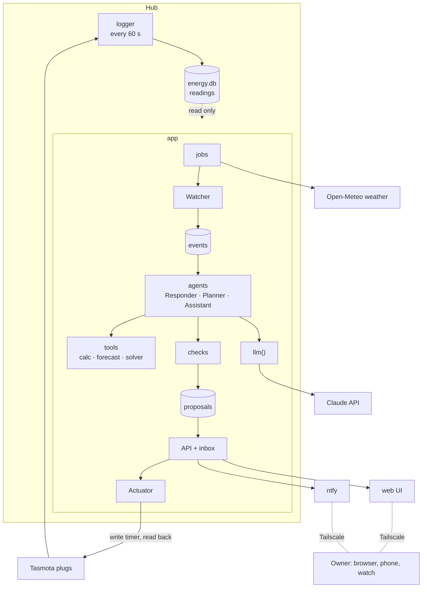

# Architecture

[Design overview](../design.md)


Two programs run on the hub: the **logger**, which already runs and only records readings, and the **app**, which does everything else. The web UI is a set of static pages the app serves. The owner reaches it only over Tailscale.



## Modules

| M | Module | What it does | Serves |
|---|---|---|---|
| M-01 | logger | Reads every plug each minute into `energy.db`. A separate program, so a crash or heavy work in the app never delays a reading | NFR-07 idle load, NFR-09 offline |
| M-02 | `store` | The only module that talks to the database. Reads `energy.db` read-only; owns `app.db` (events, proposals, rules, audit). Every table has a `site_id` so more sites fit later | NFR-08 storage, NFR-10 restart, NFR-15 scale |
| M-03 | `devices` | One interface for any device type: read, read timers, write timers, info. Tasmota over HTTP now; MQTT and Modbus later | C-04 Tasmota, NFR-15 scale |
| M-04 | `jobs` | Runs the timetable inside the app: Watcher every 15 min; weather, profiles and timer check daily; Planner weekly; proposal expiry. A run missed while the app was down runs once at start | FR-08 weather, FR-09 anomaly, FR-11 offline, FR-16 Planner |
| M-05 | Watcher | Pure code over the data; records events; never calls a model | FR-09 to FR-13 events, NFR-02 no LLM, NFR-03 ≤ 10 s |
| M-06 | events | Event rows with a status: new, running, done, held. Held events run in order when the cap resets or the internet returns | NFR-09 offline, NFR-10 restart, FR-28 budget |
| M-07 | agents | Built with LangGraph. Each run ends by saving 0 or 1 proposal; no run sits paused waiting for the owner, so a restart loses nothing | FR-15 Responder, FR-16 Planner, FR-17 Assistant, NFR-10 restart |
| M-08 | tools | Plain typed functions over `calc`, `forecast`, `solver` and `store`. Read-only: no agent can write to a device | FR-14 contract, NFR-11 grounded, NFR-12 safe writes |
| M-09 | `llm()` | The one place that calls a model: picks the model from config, logs the call and its cost, stops at the budget cap, removes IP and MAC addresses from prompts | FR-27 trace, FR-28 budget, NFR-14 privacy, NFR-18 swap provider |
| M-10 | `checks` | Validates a proposal: format, numbers, rules, access, slots ([guardrails](guardrails.md)). Runs when a proposal is made, when it is edited and before a write | FR-14 contract, NFR-11 grounded |
| M-11 | API + inbox | FastAPI. Every request needs a token. Approve, edit, reject; serves the web UI | FR-18 inbox, NFR-13 private |
| M-12 | `notify` | Sends each proposal to the phone through ntfy, with Approve and Reject buttons that call the API | FR-18 inbox, NFR-19 two taps, A-06 ntfy |
| M-13 | Actuator | The only writer. Checks again, writes timers in allowed slots, reads them back, records the result. Shadow mode stops it here | FR-19 shadow, FR-20 Actuator, FR-21 audit, NFR-06 read-back, NFR-12 safe writes |
| M-14 | `calc`, `forecast` | All maths: kWh, LKR, kgCO2e with the factor's source. `forecast(plug, horizon)` returns the profile now; a better model can replace it later behind the same call | FR-02 profiles, FR-23 maths, FR-24 baseline |
| M-15 | `solver` | Builds a week of timers: hard rules must hold, soft rules add cost | FR-05 rules, FR-16 Planner, A-07 solver speed |
| M-16 | web UI | Next.js, 4 tabs (Today, Devices, Insights, Settings) and a chat panel; see [UI](ui.md). Works at phone width | FR-18 inbox, FR-26 memory, NFR-19 phone |

## When something fails

| Failure | What happens |
|---|---|
| App stops | The logger keeps recording. On restart, missed jobs run once; proposals and held events are still there |
| Internet down | Logging, Watcher, web UI, inbox and Actuator keep working. Events are held; agents run when it returns |
| Budget cap reached | Events are held and shown in the UI; no agent run stops halfway |
| Plug offline | An offline event. A write to it fails, stays pending and is recorded |
| Read-back differs | The write is marked failed and a mismatch event is raised. No automatic retry |

## Code layout

```
logger/          plug logger (separate program)
src/agentc/
  app.py         FastAPI app; starts the jobs
  jobs.py  store.py  watcher.py  calc.py  forecast.py  solver.py
  checks.py  actuator.py  notify.py  llm.py  tools.py
  devices/       base.py (interface), tasmota.py
  agents/        responder.py, planner.py, assistant.py
ui/              Next.js, exported to ui/out
tests/  evals/   unit tests; agent eval cases
```

Python via uv, ruff clean, type hints on public functions (NFR-16). A fresh hub runs from `deploy/` scripts and the README in ≤ 30 min (NFR-20). Cost and latency targets: NFR-01 (≤ USD 3 a month) and NFR-04 (proposal ≤ 20 min after the cause), set by ADR-001.

The big calls behind this architecture are ADR-001 to ADR-006 (see the decision log).
