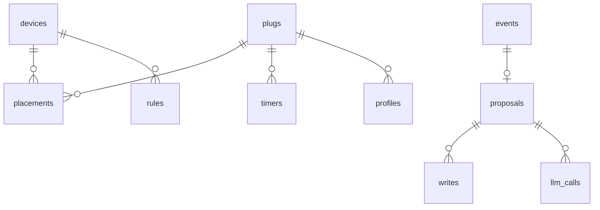

# Data

[Design overview](../design.md)


Two SQLite files on the hub's data card. `energy.db` holds the readings and belongs to the logger. `app.db` holds everything the app knows: plugs, devices, rules, events, proposals and the audit trail. Times are stored in UTC; profiles and timers use the site's local time.



## energy.db (logger)

| Table | Holds |
|---|---|
| `readings` | One row per plug per minute: `ts_utc`, `plug` (name), power, apparent and reactive power, power factor, voltage, current, kWh counter, `error` when the read failed. Exists and runs today |
| `readings_15m` | 15-minute averages, added by the logger's daily rollup |

Retention: raw minutes for 30 days; then the daily rollup writes 15-minute rows and moves the raw rows to a monthly compressed CSV on the data card, kept for forecast work (NFR-08 storage). The logger re-reads `config.toml` when the file changes, so a new plug needs no restart.

## app.db (app)

Every table also has `site_id`.

| Table | Holds | Notes |
|---|---|---|
| `sites` | Name, time zone, location for weather | Location stays on the hub |
| `plugs` | MAC (key), name, IP, first and last seen | Name links to `readings.plug`; IP may change |
| `devices` | Name, room, type, rated W, access level, allowed slots | What is plugged in |
| `placements` | Device, plug, from, to | Devices move between plugs; history kept |
| `timers` | Plug, slot 1 to 16, the Tasmota fields, source (import, actuator, owner), read at | Last read from the plug, not a plan |
| `rules` | Device, kind, parameters, hard or soft, weight, origin (owner, rejection, chat), active | Kinds: must-run window, min runtime, latest off, never off, priority |
| `profiles` | Plug, hour of week (0 to 167), median W, share of time on, days used | Rebuilt daily |
| `thresholds` | Plug, alert factor, changed by | Raised by "false alarm" marks |
| `weather` | Hourly forecast and actuals | From Open-Meteo |
| `factors` | Kind (grid, tariff), value, unit, source, valid from | Every number in a report cites one |
| `goals` | Month, kgCO2e | Set by the owner |
| `events` | Kind, plug, device, start, facts, status, dedupe key | Dedupe key: plug + kind + day |
| `proposals` | See the contract below; status; version | Each edit makes a new version |
| `writes` | Proposal, plug, slot, before, after, read back, ok | One row per timer written |
| `audit` | Time, actor (code, agent, owner), action, reference, detail | Append only; the history page reads it |
| `llm_calls` | Run, agent, model, prompt version, prompt, output, tokens, USD, latency | Trace and budget |
| `settings` | Shadow mode, paused, caps, defaults | Each change also goes to `audit` |
| LangGraph tables | Chat threads | Managed by the library |

## Proposal contract (FR-14)

```json
{
  "id": "p-0142", "version": 1, "source": "responder", "event_id": "e-0388",
  "device": "Desk 2",
  "changes": [{"slot": 9, "action": "off", "time": "01:30", "days": "SMTWTFS"}],
  "reason": "Desk 2 stayed on until 06:00 on 2 of the last 11 nights; on other nights it is off by 01:00.",
  "savings_week": {"kwh": 0.06, "lkr": 3, "kgco2e": 0.03},
  "factors": ["grid-2025", "tariff-2026-11"],
  "evidence": ["2 nights on until 06:00 vs profile", "usage until 00:50 on 2 nights"],
  "warnings": [],
  "expires": "2026-11-14T01:30:00+05:30"
}
```

Savings in the example are illustrative, sized from the real readings. Default expiry: 24 h for the Responder and Assistant, the next Sunday run for the Planner.

## Tasmota timers

A plug has 16 timers. The app reads them all with `Timers` and writes one with `TimerN` plus a JSON value.

| Tasmota field | Values | Our use |
|---|---|---|
| `Enable` | 0, 1 | 1 when written |
| `Mode` | 0 time, 1 sunrise, 2 sunset | Agents write 0 only; imported 1 and 2 are kept and shown |
| `Time` | `HH:MM`, local time on the plug | From the proposal |
| `Window` | 0 to 15 min random offset | 0 |
| `Days` | 7 characters, Sunday first; `1` or the day letter = on, `0` or `-` = off | From the proposal |
| `Repeat` | 0 once, 1 weekly | 1 |
| `Output` | Relay number | 1 |
| `Action` | 0 off, 1 on, 2 toggle, 3 rule | 0 or 1 only |

- **Slots:** the Actuator writes only slots listed for the device (default 9 to 16). Slots 1 to 8 are imported as the owner's and never changed.
- **Global switch:** timers fire only when the plug's `Timers` setting is on. Import checks it; if it is off, that becomes a setup question, not a silent write.
- **Clock:** plugs must keep local time (A-02). Import reads `Time` and `Timezone` and raises a setup question when they are wrong.
- **Read-back:** after a write the Actuator reads the same slot and compares every field.
