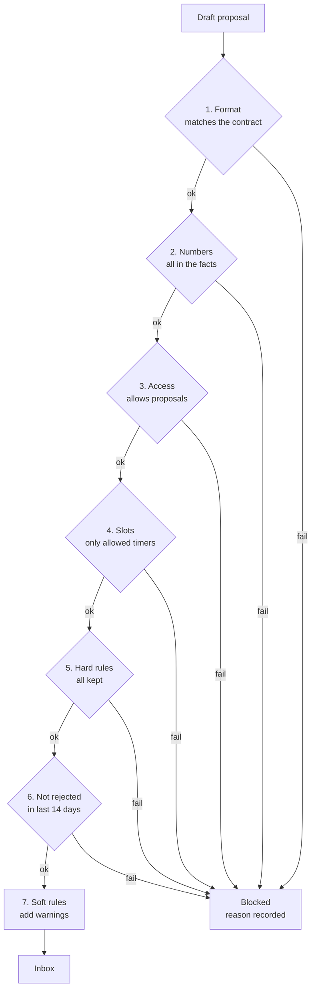

# Guardrails

[Design overview](../design.md)

Guardrails are code that stops a bad change from reaching a plug, whatever an agent writes. They are layered: if one layer misses, the next still holds. The strongest guard is the design itself: agents have no write tools, so the worst a confused or manipulated agent can do is draft a proposal that the checks block or the owner rejects.

## Layers

| Layer | Where | Guards against |
|---|---|---|
| 1. Input | Code builds the facts; `llm()` | Raw data in prompts, private addresses, untrusted text treated as instructions |
| 2. Model run | Agent graph | Runaway loops and cost: tool-call limit, token limit per run, time limit |
| 3. Proposal checks | `checks` | Wrong format, made-up numbers, broken rules, wrong device or slot, repeats |
| 4. Owner | Inbox | Anything the checks cannot judge: is this change sensible for my home? |
| 5. Write | Actuator | Stale approvals, rules changed since approval, shadow mode, write storms, silent failures |
| 6. System | API, network, budget | Outside access, spend over the cap |

## Who sets what

| Kind | Examples | Set by | Editable |
|---|---|---|---|
| Fixed invariants | Only the Actuator writes · every write is audited and read back · budget cap is enforced | Code | No (v1) |
| Owner policy | Access level per device · allowed timer slots · hard and soft rules · goal · caps | Owner, at setup and on the devices page | Yes, every change audited |
| Learned | Soft rules from rejections · per-plug alert thresholds | System, from owner actions | Yes, on the device page and in Settings |

Nothing about a specific home is in code. "Never touch the 3D printer" is an owner setting (access *none*), not an `if` statement.

## Proposal checks, in order

Cheap checks run first. Each block is recorded with the check that failed, so error analysis can count them.

- **Grounded numbers (check 2).** Code pulls every number out of the agent's text and matches it against the facts the agent was given, after rounding to the shown precision. Times and dates count as numbers. One unmatched number fails the draft (NFR-11 grounded).
- **Same change (check 6).** A change is the same when device, action (on or off), days and time match within 30 minutes.
- **Access *Advice*** (`propose` in requirements FR-04). The proposal reaches the inbox as advice; the Approve button is replaced by "Done it myself".

## At write time

The Actuator runs these just before writing, because time has passed since the proposal was made.

- The approval exists, is for this exact version of the proposal, and has not expired.
- Checks 3 to 5 run again against today's rules and access.
- Shadow mode off; device access *write after approval*.
- At most 4 writes per plug per day, so a bad loop cannot keep switching a device.
- Writes touch only the allowed slots; the owner's own timers are never changed or cleared.
- Read back within 30 s (NFR-06). A mismatch marks the write failed and raises an event; no automatic retry.

## Untrusted text

| Source | Risk | Handling |
|---|---|---|
| Chat messages | Owner asks for something unsafe | Same checks as any proposal; access *none* refused |
| Device and rule names | Text that reads like an instruction | Passed inside the facts block as data, never as instructions |
| Uploaded documents (later) | Instructions hidden in a PDF | Text passed as quoted data; the only output is a factor value the owner approves |
| Weather API | Bad values | Range-checked by code; a failed fetch leaves the profile alone |

## System guards

- **Network:** Tailscale only; no port open to the internet (NFR-13 private).
- **API:** a token on every request. Phone buttons carry a single-use token for that one proposal and action, valid until the proposal expires.
- **Notifications:** ntfy runs on the hub. Proposal text never leaves the hub; for iOS push, the public ntfy server relays only a message id and the phone fetches the content over Tailscale (to verify, A-06).
- **Budget:** per-run token limit; monthly USD cap in `llm()`. At 80% the owner is told; at 100% events are held (FR-28 budget).
- **Stop button:** one switch turns on shadow mode and pauses all agents. Logging and the Watcher keep running.
