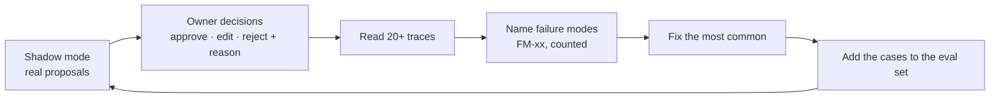

# Test and eval strategy

[Design overview](../design.md)

Code is tested like any software, with fixed inputs and exact answers. Agents are tested on fixed cases too, scored by code wherever possible, because their output can vary. Then the whole system is replayed on recorded data, and finally the owner judges it for real in shadow mode. The cases live in [evaluation.md](../evaluation.md); this page says how they run.

## Levels

| Level | What | How | When | Pass |
|---|---|---|---|---|
| 1. Unit | `calc`, `watcher`, `checks`, `solver`, `store`, `forecast` | pytest on fixtures | Every commit | All green; core modules ≥ 80% lines (NFR-17) |
| 2. Integration | API, Actuator, jobs | A fake Tasmota plug (small HTTP server in tests) that can go offline or return a different timer | Every commit | Read-back mismatch, offline plug, restart and shadow mode behave as in [architecture](architecture.md) and [guardrails](guardrails.md) |
| 3. Agent evals | Responder, Planner, Assistant | EV cases: fixed facts in, scorers on the output | Recorded: every commit. Live: when a prompt, model or tool changes | Thresholds below |
| 4. Replay | The whole loop | Recorded weeks of readings played through Watcher and agents on a fast clock | Before shadow mode; after big changes | Events a week, event precision, projected monthly cost |
| 5. Load | Scale | 100 simulated plugs for a simulated month | Once before v1, then on storage changes | NFR-15 scale |
| 6. Shadow mode | Real use | 2 weeks on the hub, nothing written | Once, then on major versions | SM-02, SM-03 |
| 7. Old vs new | Cost | The same inputs through AgentC and the rebuild | Once, at Evaluate | SM-01 |

## Agent evals

- **Recorded and live.** Each live run saves the model's responses. Every commit replays them for free, so code changes around the agents are tested without spending. Live runs, which cost money, happen only when a prompt, model or tool changes.
- **Code scorers first.** Most of what matters can be checked exactly:

| Scorer | Checks | Threshold |
|---|---|---|
| Contract | Output matches the proposal schema | 100% |
| Grounded | Every number is in the facts | 100% |
| Safety | No proposal for access *none*; refusals where expected | 100% |
| Choice | Picked the expected option, or *no action* when expected | ≥ 90% |
| Planner plan | Matches a solver output; meets the goal or reports the shortfall | 100% |
| Budget | Within tool-call and token limits | 100% |

- **An LLM judge only for wording.** A second model scores whether the reason is clear and matches the evidence, on a 1 to 5 rubric. Before its scores count, it is checked against the owner's own scores on 20 cases and must agree on at least 16.
- **Each case cites its requirement** (`EV-xx` serves `FR-xx`), so a script can show every FR has a test or an eval (SM-07).

## From shadow mode to better agents

- **Labels come from normal use.** "False alarm" marks and reject reasons label events and proposals; no separate labelling job.
- **Event precision (SM-03)** is the share of events the owner did not mark as a false alarm.

## Test data

- Fixtures are cut from real readings, with plug names only: no IPs, MACs or location (NFR-14 privacy).
- The AgentC side of the old vs new run is done privately, because AgentC's source stays out of this repo. The public report gives the method and the percentage, not thesis figures.
