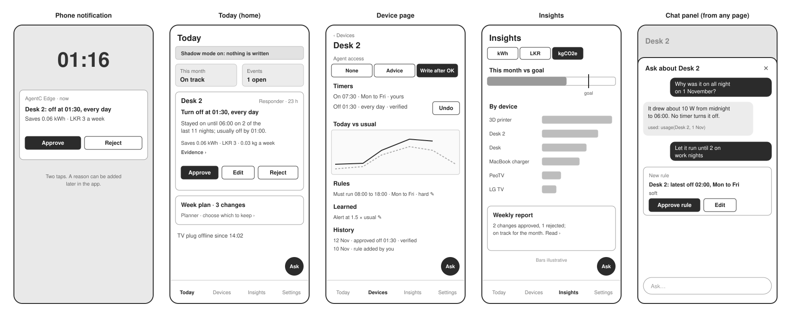

# UI

[Design overview](../design.md)

The owner has four jobs: decide on proposals, look after devices, see how the month is going, and stay in control. The app has one tab for each, and chat is a panel that opens from any page. Approving can also happen straight from a phone notification.

Low-fidelity, at phone width. Device names and the Desk 2 case come from the reference home; savings figures are illustrative.

## Tabs

| Tab | For | Holds | Serves |
|---|---|---|---|
| **Today** (home) | Deciding | Proposals as cards; month status; open events and grid events; shadow-mode banner | FR-12 grid, FR-18 inbox, FR-19 shadow, FR-22 goal |
| **Devices** | Looking after devices | List of devices; each device page has its access level, timers in plain words, today vs usual, rules, what was learned, and its history | FR-04 setup, FR-05 rules, FR-06 discovery, FR-07 change, FR-21 audit, FR-26 memory |
| **Insights** | Seeing progress | Month vs goal; kWh, LKR or kgCO2e by device; the weekly report | FR-16 report, FR-22 goal, FR-23 maths |
| **Settings** | Control | Stop button, shadow mode, goal, factors and tariff with sources, budget and model costs, everything learned in one list, the full audit log | FR-19 shadow, FR-23 maths, FR-26 memory, FR-27 trace, FR-28 budget |
| **Chat** (panel) | Asking | Opens over any page; from a device page it is already about that device; shows the tools it used; proposals appear as cards | FR-17 Assistant |

## Design choices

- **Organised by the owner's jobs, not by the system's parts.** Memory and history sit on each device page, where they are needed; Settings keeps the full lists.
- **Plain words first.** Timers read as "Off at 01:30, every day". Tasmota fields only appear under Evidence.
- **Every number can be opened.** Tapping a saving shows how code computed it and which factor it used.
- **Undo on every verified change.** It creates a proposal that restores the previous timer (kept in `writes`). Tapping Undo counts as the approval; the checks still run.
- **Write status on the card:** approved, written, verified, or failed with the reason.
- **Trust ladder per device:** None, Advice, Write after approval, shown as steps with what each allows. New devices start at Advice.
- **Planner plans as a checklist:** one card, each change can be switched off before approving, with the saving total updating.
- **Reject asks why,** with quick reasons ("I need it on then", "wrong device", "false alarm") and free text. From the phone the reason can be added later.
- **Empty states that explain.** In the first week: "Learning your home: first proposals in 3 days".
- **Stop is always one tap away** in Settings: shadow mode on and agents paused.

## The proposal card

| Part | Shows |
|---|---|
| Header | Device, which agent, time left |
| Change | One sentence: "Turn off at 01:30, every day" |
| Reason | Two sentences at most, numbers only from the facts |
| Saving | kWh, LKR, kgCO2e a week; each opens its calculation |
| Warnings | Soft rules it bends, if any |
| Evidence | Readings, profile, Tasmota fields |
| Actions | Approve, Edit, Reject. With access Advice: "Done it myself" instead of Approve |

Edit opens the change; saving it makes a new version and runs the checks again.

## First run

1. **Site:** name, time zone, location for weather.
2. **Plugs:** discovery lists the plugs found; the owner names each device and sets its access. Default access is Advice, so nothing can be written until the owner raises it.
3. **Timers:** import reads every plug's timers and clock; problems become setup questions.
4. **Goal and numbers:** monthly kgCO2e goal, grid factor and tariff, each with its source.
5. **Shadow mode is on** by default. First proposals arrive once each plug has 7 days of readings.

## Build

- Next.js, exported as static files and served by the app (C-06). No server-side rendering, so nothing extra runs on the hub.
- One API client module; the UI asks for the API token once and keeps it in the browser.
- Works at phone width, light and dark (NFR-19 phone). Charts stay simple: bars by device, a line of today vs usual.
